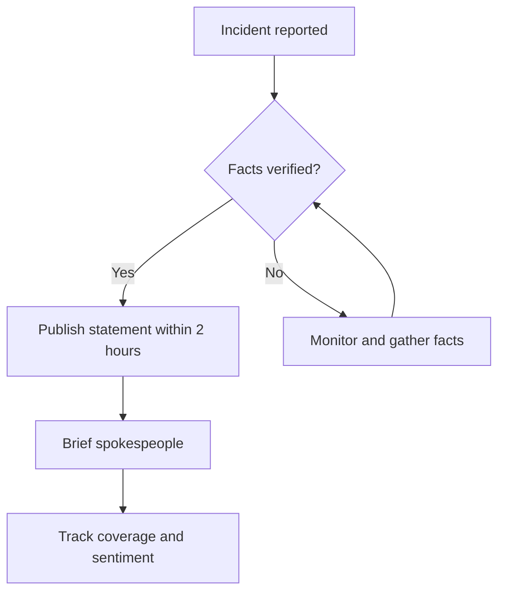
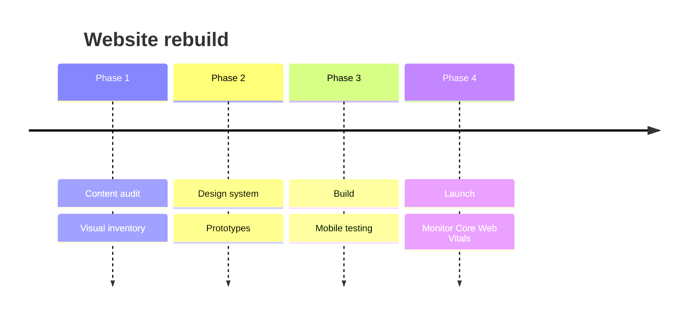
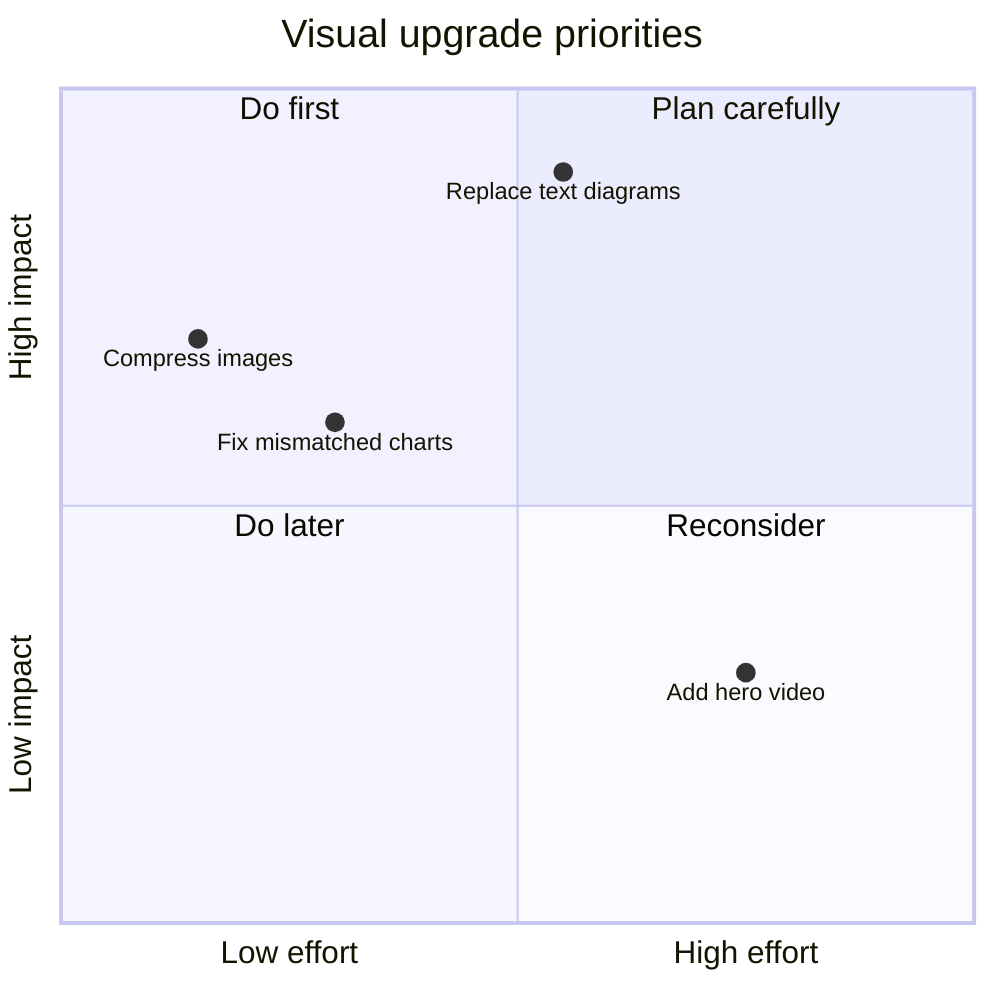

# The Ultimate Guide to Website Visuals

### Every visual a modern website can use: what it is, when it earns its place, and how to build it well

**Prepared for:** Firefly Management
**Compiled:** September 2026
**Format:** Reference handbook (Markdown)

---

## How to use this guide

Parts 1 to 8 are catalogues. Each entry says what the visual is, when to use it, and what usually goes wrong. Parts 9 to 12 are standards: current trends, accessibility, performance, and mobile-first delivery for a Kenyan audience. Part 13 lists tools, Part 14 is a one-page chooser, and Part 15 is a pre-launch checklist.

One rule runs through the whole guide: **a visual must do a job that text cannot do as well.** It should show a shape, a sequence, a relationship, a place, a person or a feeling. If it only decorates, cut it.

---

## Contents

1. [Foundations: The Visual System](#1-foundations-the-visual-system)
2. [Layout and Page-Structure Visuals](#2-layout-and-page-structure-visuals)
3. [Imagery](#3-imagery)
4. [Data Visualisation: Charts](#4-data-visualisation-charts)
5. [Diagrams and Information Design](#5-diagrams-and-information-design)
6. [Infographics and Visual Storytelling](#6-infographics-and-visual-storytelling)
7. [Motion and Interactive Visuals](#7-motion-and-interactive-visuals)
8. [Interface Component Visuals](#8-interface-component-visuals)
9. [Visual Trends in 2026](#9-visual-trends-in-2026)
10. [Accessibility Standards for Visuals](#10-accessibility-standards-for-visuals)
11. [Performance and Technical Delivery](#11-performance-and-technical-delivery)
12. [Mobile-First and Low-Bandwidth Design (Kenya Focus)](#12-mobile-first-and-low-bandwidth-design-kenya-focus)
13. [Tools and Libraries](#13-tools-and-libraries)
14. [Quick Chooser: What to Use When](#14-quick-chooser-what-to-use-when)
15. [Pre-Launch Visual QA Checklist](#15-pre-launch-visual-qa-checklist)
- [Appendix A: Glossary](#appendix-a-glossary)
- [Appendix B: Sources and Further Reading](#appendix-b-sources-and-further-reading)

---

## 1. Foundations: The Visual System

Before choosing any single visual, a site needs a system: a small set of decisions that every chart, photo and button inherits. Most sites that look "designed" are simply consistent.

### 1.1 Visual hierarchy

Hierarchy tells the eye where to look first, second and third. The levers are size, weight, contrast, colour, position, whitespace and (sparingly) motion.

| Lever | How it creates priority | Common mistake |
|---|---|---|
| Size | Bigger elements are read first | Making everything large, so nothing leads |
| Weight | Bold type pulls attention | Bolding whole paragraphs |
| Contrast | High contrast advances, low contrast recedes | Low-contrast grey body text that fails accessibility |
| Colour | One accent colour marks the key action | Using the accent on decoration as well as actions |
| Position | Top and left (in left-to-right languages) are seen first | Burying the main action below the fold |
| Whitespace | Isolation signals importance | Filling every gap with content |
| Motion | Movement grabs attention instantly | Animating many things at once |

**The squint test:** blur your eyes at any screen. You should still see one dominant element. If you see five competing blobs, the hierarchy is broken.

**Scanning patterns to design for:**
- **F-pattern:** on text-heavy pages people scan down the left edge and across a few lines. Put meaning in the first words of headings and paragraphs.
- **Z-pattern:** on sparse landing pages the eye moves logo → navigation → headline → call to action.
- **Layer-cake pattern:** many readers scan only headings. Headings must carry the message on their own.

### 1.2 Colour

A working palette has roles, not just colours.

| Role | Typical size | Job |
|---|---|---|
| Neutrals | 6–10 steps from near-white to near-black | Backgrounds, text, borders; they carry most of the interface |
| Primary (brand) | 1 hue with tints and shades | Identity and main actions |
| Accent | 1 hue | The single thing you most want noticed |
| Semantic | 3–4 hues | Success, warning, error, info; status only, never decoration |
| Categorical data | 5–8 distinguishable hues | Different groups in charts |
| Sequential data | One hue from light to dark | Low-to-high values (maps, heatmaps) |
| Diverging data | Two hues meeting at a neutral midpoint | Below/above a reference (loss/gain, disagree/agree) |

**Rules:**
- Define colours as design tokens (CSS custom properties) so light and dark themes swap cleanly.
- Design dark mode deliberately rather than inverting: reduce saturation, and make raised surfaces slightly lighter than the page.
- Colour must never be the only carrier of meaning. Pair it with a label, icon, pattern or position.
- Check every text and graphic colour pair against the contrast minimums in Part 10.

### 1.3 Typography

Type carries a site's personality more than any image.

- **One or two families.** If two, make them clearly different (for example a serif display face with a sans-serif body).
- **Use a type scale.** Pick a ratio and generate sizes from it: about 1.2 for dense interfaces, 1.25 for general sites, 1.333 or more for editorial sites.
- **Body text:** 16–18 px on screens, line height around 1.5 (a little more for serif body text), and line length of roughly 45–80 characters.
- **Variable fonts** give many weights and widths from one file, which is good for both performance and expressive headlines.
- **Type as the visual:** oversized or kinetic headlines can replace stock imagery entirely.
- **Numbers:** use tabular figures (`font-variant-numeric: tabular-nums`) in tables and dashboards so digits line up.
- **Sentence case** reads faster than ALL CAPS for anything longer than a couple of words.

### 1.4 Grid, spacing and rhythm

- **Column grid:** 12 columns on desktop (divides by 2, 3, 4 and 6), 8 on tablet, 4 on mobile; gutters of 16–32 px.
- **Spacing scale** on a 4 px or 8 px base, for example 4, 8, 12, 16, 24, 32, 48, 64, 96. Use only values from the scale.
- **Content width:** layouts usually max out around 1100–1280 px; reading columns around 65–75 characters.
- **Vertical rhythm:** keep consistent gaps between sections so the page feels intentional.

### 1.5 Gestalt principles (why layouts read the way they do)

| Principle | What the eye does | Web example |
|---|---|---|
| Proximity | Groups things that are close together | A label sits closer to its own input than to the next field |
| Similarity | Groups things that look alike | All links share one colour and underline |
| Common region | Groups things inside the same boundary | Cards, panels, shaded sections |
| Continuity | Follows lines and curves | Timelines, flow arrows, aligned edges |
| Closure | Completes incomplete shapes | Icon sets drawn with open strokes |
| Figure–ground | Separates object from background | Modals over a dimmed page |
| Focal point | Notices whatever is different | One coloured button among neutral ones |

### 1.6 Shape, depth and elevation

- **Border radius is information.** Vary it by hierarchy (smaller on inputs and chips, larger on containers) rather than applying one radius everywhere.
- **Elevation** (shadow or tonal surface) shows layers: menus and dialogs sit above the page.
- **Grouping methods:** borders, whitespace, or background tints. Choose one as the main method; mixing all three looks busy.

### 1.7 Avoiding the templated look

Templates and AI site builders have made certain looks extremely common, and audiences increasingly read them as generic. Recognisable defaults include:

- A warm cream background with a high-contrast serif and a terracotta accent.
- A near-black background with one neon green or vermilion accent.
- Content chopped into identical rounded cards, each with the same soft grey shadow and gradient washes as decoration.
- A tracked-out ALL-CAPS label above every heading, meta text joined with middle dots, and arrows appended to every link.
- Numbered markers (01 / 02 / 03) on content that is not actually a sequence.
- Every section fading and sliding up as it scrolls into view.

None of these is wrong for every brief, but each is a default rather than a choice. **The remedy:** take visual cues from the subject's own world (its materials, places, people, vernacular and local type), spend your boldness on one memorable element, and keep everything around it quiet.

---

## 2. Layout and Page-Structure Visuals

### 2.1 Hero sections

The hero is the first screen. It should show the most characteristic thing about the subject, in the form that suits it best.

| Hero type | Best for | Watch out for |
|---|---|---|
| Headline-led (typographic) | Strong message, bold brands, fast loading | Weak copy has nowhere to hide |
| Full-bleed photograph | People, places, events, products | Text over busy photos fails contrast; add an overlay |
| Video or cinemagraph | Atmosphere, events, venues, performances | Heavy on mobile data; needs a poster frame and pause control |
| Product or interface demo | Apps and tools | Screenshots go stale; keep them current |
| Interactive (map, calculator, live data) | Civic tools, data products | Must work without the interaction too |
| Split (text beside a visual) | Most general sites | Stacks awkwardly on mobile if not planned |
| Data-led (one big number) | When a single figure truly is the story | Overused; a big number with a small label has become a cliché |
| Rotating carousel | Rarely justified | Later slides are seldom seen; auto-rotation harms accessibility |

**Hero checklist:** one message, one primary action, and a hero image optimised for speed, because it is usually the largest element on the page (see Part 11).

### 2.2 Section and layout patterns

| Pattern | What it looks like | Best for | Watch out for |
|---|---|---|---|
| Split screen | Two halves, often text and image | Contrasting two ideas, sign-up pages | Stacking order on mobile |
| Alternating zig-zag | Image left/text right, then swapped | Feature explanations | Becomes monotonous past 3–4 rows |
| Card grid | Equal tiles in rows | Articles, products, team members, events | Identical cards flatten hierarchy |
| Bento grid | Tiles of different sizes on a strict grid; bigger tile = more important | Feature summaries, portfolios, dashboards, homepages | Needs logical source order for keyboard and screen-reader users |
| Masonry | Columns of uneven-height items | Photo galleries, portfolios | Reading order is unclear |
| List or table | Dense rows | Comparable items, results, directories | Needs a mobile treatment |
| Editorial / magazine | Varied column widths, pull quotes, large images | Long reads, reports, features | Harder to template |
| Anti-grid / organic | Overlaps, irregular placement, flowing shapes | Creative and cultural brands | Can hurt readability if overdone |
| Full-bleed band | Edge-to-edge colour or image strip | Section breaks, big statements | Too many make the page feel loud |
| Sticky side-by-side | A visual pinned while text scrolls beside it | Explainers, step-by-step stories | Must collapse sensibly on phones |
| Tabs | Parallel panels behind labelled tabs | Alternatives of equal weight | Hidden content is often missed |
| Accordion | Expandable rows | FAQs, detailed specifications | Do not hide essential information |
| Stats band | 3–4 key figures in a row | Proof points | Numbers without context mean little |
| Logo wall | Grid of partner or client logos | Social proof | Use monochrome versions for consistency |
| Testimonial block | Quote, photo, name, role | Trust | Must be real, attributable people |
| Pricing table | Plans in columns | Offers and packages | Highlight the recommended plan |
| Call-to-action band | Short line and a button | Ending sections and pages | One action per band |
| Fat footer | Sitemap, contacts, social links | Navigation safety net | Keep it scannable |

### 2.3 Page archetypes and their visual anatomy

- **Landing page:** hero → proof (logos or stats) → problem → solution and features → how it works (steps) → testimonials → offer or pricing → FAQ → final call to action.
- **Long-form article or report:** headline, standfirst, byline and date, lead image, body with inline charts and diagrams, pull quotes, side notes, sources, related links.
- **Campaign or advocacy site:** hero featuring the person or cause, pillars (icon plus short text), track record (timeline, before/after), local impact map, events calendar, volunteer and donate actions, news, shareable cards.
- **Dashboard or analytics app:** global filters, KPI row, primary chart, secondary charts, detail table, "last updated" stamp.
- **Artist or talent page:** hero visual, music or video embeds, releases grid, streaming stats, press quotes, tour dates, booking contact.
- **Radio or media station site:** live player, programme schedule grid, presenter profiles, podcasts, news, advertising rate card.
- **Event page:** date/time/venue block, countdown, line-up grid, venue map, ticket tiers, gallery from previous editions.
- **Product page:** zoomable gallery (optionally 360° or 3D), price, variants, reviews, specifications table.

### 2.4 Navigation visuals

| Element | Use it for | Notes |
|---|---|---|
| Top navigation bar | Most sites | Keep to 5–7 items |
| Mega menu | Large sites with many sections | Group links under clear headings |
| Hamburger menu | Mobile navigation | Label it "Menu" if your audience is less tech-savvy |
| Bottom tab bar | Mobile web apps | Thumb-friendly; 3–5 destinations |
| Sidebar | Dashboards, documentation | Collapsible on smaller screens |
| Breadcrumbs | Deep hierarchies | Shows where the reader is |
| Sticky table of contents | Long reports | Highlight the current section |
| Reading-progress bar | Long articles | Thin bar at the top of the viewport |
| Pagination / Load more / Infinite scroll | Lists and feeds | Infinite scroll makes footers unreachable; prefer "Load more" |

---

## 3. Imagery

### 3.1 Photography

| Type | What it shows | Best for |
|---|---|---|
| Documentary / reportage | Real moments, unposed | Civic work, events, impact stories, journalism |
| Portrait | A person, deliberately lit and framed | Leaders, artists, team pages, presenters |
| Product | Objects on clean or styled backgrounds | Shops, merchandise, packaging |
| Lifestyle | Products or services in real use | Consumer brands, hospitality |
| Editorial / conceptual | Staged images expressing an idea | Features, opinion pieces |
| Aerial / drone | Landscape, scale, geography | Places, infrastructure, projects, rallies |
| Archival / historical | The past | Timelines, anniversaries, heritage |

**Guidance:**
- Real beats stock. Local faces and recognisable places build trust faster than generic imagery.
- Give all photos a consistent treatment (colour grade, crop style, framing).
- Use art direction: serve a different crop to phones (tighter, portrait) and desktops (wider) using the `<picture>` element.
- Faces looking into the page pull the reader towards the content.
- Never bake important text into a photo; it cannot be translated, searched, resized or read by screen readers.
- Get consent for identifiable people, especially children, and credit photographers.
- On news and civic sites, never alter documentary photos in ways that change their meaning.

### 3.2 Illustration

| Style | Character | Good for |
|---|---|---|
| Flat / vector | Clean shapes, solid colour | Explainers, onboarding, icons |
| Line art | Single-weight strokes | Minimal brands, technical subjects |
| Isometric | 3D-looking, drawn at fixed angles | Systems, cities, processes |
| Hand-drawn / sketch | Imperfect, human | Warm, approachable brands |
| Collage / mixed media | Cut-out photos plus drawing | Culture, music, editorial |
| Editorial illustration | Conceptual, commissioned art | Opinion, analysis, features |
| Character / mascot | A recurring figure | Youth brands, campaigns, education |
| Spot illustration | Small drawings beside text | Empty states, section breaks |
| 3D-rendered | Soft, tactile objects | Tech products, playful brands |

Keep one illustration system: the same stroke weight, palette, perspective and level of detail across the whole site.

### 3.3 Icons

- **Types:** interface icons (search, close, menu), feature pictograms, social and brand icons, flags.
- **Styles:** outline, filled, duotone. Pick one family and stay with it.
- **Build on one grid** (commonly 24 × 24 px) with consistent stroke width.
- **Label icons** unless their meaning is universal (search, close, menu, play).
- Icons that convey meaning need at least 3:1 contrast against their background.
- Deliver as inline SVG or an SVG sprite so they stay sharp and can inherit text colour.

### 3.4 3D, WebGL and augmented reality

Interactive product models, 3D scenes, globes, particle fields, virtual tours and "view in your room" AR previews.

- **Cost:** large files, battery drain, GPU load, and slow first paint on budget phones.
- **Always provide** a static image fallback, load 3D only when it is needed, and respect reduced-motion settings.
- **Use it when** spatial understanding is the point (a venue, a product, a building project), not as decoration.

### 3.5 Backgrounds and textures

| Treatment | Effect | Caution |
|---|---|---|
| Solid tonal blocks | Calm, clear sectioning | Can feel flat without good type |
| Linear or radial gradients | Depth and energy | Text contrast varies across the gradient |
| Mesh gradients | Soft, organic colour fields | Can look generic if overused |
| Grain / noise overlay | Tactile, print-like warmth | Keep subtle; heavy grain hurts legibility |
| Patterns | Identity, cultural reference | Use local motifs respectfully and with meaning |
| Duotone photos | Brand-coloured imagery | Loses detail |
| Blurred photo backgrounds | Atmosphere behind text | Check contrast |
| Frosted glass panels | Layered, modern | Contrast often fails; test carefully |
| Dot or line grids | Technical, precise | Keep very light |

### 3.6 Video and moving media

- **Background loops:** muted, short (under about 15 seconds), compressed, with a poster frame and a visible pause button.
- **Explainers and product demos:** captions are required; keep them under two minutes where possible.
- **Testimonial and interview clips:** real voices build trust quickly.
- **Live streams and replays:** events, radio, launches.
- **Cinemagraphs:** a still photo with one moving element; atmospheric and lighter than full video.
- **Replace animated GIFs** with MP4 or WebM, which are far smaller for the same clip.
- **Vertical short video embeds** suit audiences used to TikTok, Reels and Shorts.
- **Audio visuals:** waveforms, audio players with artwork, and live "now playing" cards for radio, podcasts and music.

### 3.7 AI-generated imagery

Useful for concept art, backgrounds, textures and illustration, but it needs rules:

- Keep a written style guide for prompts so images stay consistent.
- Label synthetic images wherever they could be mistaken for real photographs.
- **Never** generate realistic images of real people, real events or anything presented as evidence. On civic, political and news sites this destroys trust and may break election or misinformation rules.
- Check for artefacts (hands, text, logos, duplicated faces).
- Check the tool's licence terms for commercial use.

### 3.8 People and identity visuals

Avatars (photo, initials, or illustrated), team and presenter grids, author bylines, speaker cards, partner and client logos, certifications and trust badges.

---

## 4. Data Visualisation: Charts

Start every chart with one question: **what relationship in the data matters?** The Financial Times' *Visual Vocabulary* groups charts by nine relationships: deviation, correlation, ranking, distribution, change over time, magnitude, part-to-whole, spatial and flow. This part follows that structure, then adds KPI visuals, tables and chart craft.

### 4.1 Deviation: difference from a reference point

The reference is usually zero, but it can be a target or a long-term average. Also used for sentiment.

| Chart | Use when | Avoid when |
|---|---|---|
| Diverging bar | Values fall above and below a baseline (surplus/deficit by region) | There is no meaningful baseline |
| Diverging stacked bar | Survey sentiment on a scale (disagree ↔ agree) | There are many answer categories |
| Spine chart | One total split into two opposing parts (for/against, male/female) | More than two parts |
| Surplus/deficit filled line | The balance between two series over time | Many series |
| Deviation lollipop | Many categories where bars feel heavy | Values are all close together |

### 4.2 Correlation: how two or more variables relate

Readers tend to assume that a relationship you show them is causal, so say explicitly when it is not.

| Chart | Use when | Avoid when |
|---|---|---|
| Scatter plot | Two continuous variables, each on its own axis | Few data points |
| Bubble chart | A third variable shown as circle size | Precise comparison of the third variable is needed |
| Connected scatter | How the relationship between two variables changed over time | The audience is unfamiliar with charts |
| Column + line | An amount (columns) against a rate (line) | You would need two unrelated axes to make it work |
| XY heatmap | Patterns between two categories (day × hour, region × issue) | Fine differences in amounts matter |

### 4.3 Ranking: position in an ordered list matters most

| Chart | Use when | Avoid when |
|---|---|---|
| Ordered horizontal bar | Rankings with long labels; works best on phones | Order is not meaningful |
| Ordered column | Short labels, few items | Long category names |
| Lollipop | Many items; lighter than bars | Values need precise reading |
| Dot strip plot | Several values per item | Audience needs simple bars |
| Slope chart | Rank or value change between two points in time | More than two time points |
| Bump chart | Rank changes across many periods (charts, league tables) | Values matter more than ranks |
| League table with inline bars | Rankings where readers look up exact values | Many columns on mobile |

### 4.4 Distribution: how values spread out

| Chart | Use when | Avoid when |
|---|---|---|
| Histogram | Frequency of values in bins (incomes, ages) | Very few data points |
| Box plot | Comparing spread across groups | General audiences unfamiliar with quartiles |
| Violin plot | Showing the full shape of a distribution | General audiences |
| Dot / strip plot | Every individual value is visible | Thousands of points overlap |
| Beeswarm | Individual points without overlap | Very large datasets |
| Population pyramid | Age and sex structure | Other data types |
| Cumulative curve | "What share falls below X?" | Readers need raw counts |
| Ridgeline | Many distributions compared in one view | Few groups |

### 4.5 Change over time

| Chart | Use when | Avoid when |
|---|---|---|
| Line | Continuous trends; the default for time series | Very few data points |
| Column | A few discrete periods (quarters, years) | Long series |
| Area | Volume or cumulative totals | Several overlapping series |
| Stacked area | Composition changing over time | Readers need to read upper layers precisely |
| Slope | Just two time points (before/after) | Middle values matter |
| Step line | Values that change in jumps (prices, tariffs, fees) | Smooth trends |
| Sparkline | A tiny trend inside text or a KPI card | Detail is needed |
| Fan chart | Forecasts with widening uncertainty | Presenting certainty |
| Calendar heatmap | Daily patterns across a year | Few days of data |
| Candlestick | Market prices | Anything else |
| Timeline chart | Durations and overlaps (terms of office, projects) | Point events only |
| Streamgraph | Many series, when overall texture matters more than precision | Precise comparison |

> **Tip:** a measure tracked across several election cycles is a trajectory. Show it as a line or slope chart, not as grouped bars.

### 4.6 Magnitude: comparing size

| Chart | Use when | Avoid when |
|---|---|---|
| Column / bar | Comparing counts or amounts across categories | Axis does not start at zero |
| Grouped (paired) bar | Two or three series side by side | More than about three series |
| Pictogram / isotype | Making numbers human ("1 icon = 1,000 people") | Precise values are needed |
| Proportional symbol | Very different magnitudes | Precise comparison |
| Bullet chart | Actual against target with performance bands | Audiences expecting gauges without guidance |
| Radar | Profiles across a few variables | More than about 6–8 axes; precise comparison |
| Parallel coordinates | Many variables across many items | General audiences |
| Marimekko | Size and share at once (market by segment) | Many small segments |

### 4.7 Part-to-whole

| Chart | Use when | Avoid when |
|---|---|---|
| Stacked bar / 100% stacked bar | Composition across several groups | Many segments |
| Pie / donut | One whole, five or fewer parts, one clear message | Comparing across several pies |
| Waffle (10 × 10 grid) | Percentages that must be instantly readable | Values below 1% |
| Treemap | Hierarchical parts (budget → department → programme) | Precise comparison |
| Sunburst | Multi-level hierarchies | More than three levels |
| Parliament / arc chart | Seat allocation in an assembly | Non-seat data |
| Gridplot | Small multiples of part-to-whole | Many categories |
| Venn / Euler | Overlaps between sets | Showing precise quantities |

### 4.8 Spatial: where things happen

| Map | Use when | Watch out for |
|---|---|---|
| Choropleth (shaded areas) | Rates per area (per capita, percentage) | Raw counts mislead; large empty areas dominate |
| Proportional symbol map | Counts at locations | Overlapping symbols |
| Dot density | Distribution of many individuals | Implies precise locations |
| Hex or tile map | Every area gets equal space (for example Kenya's 47 counties) | Readers lose true geography |
| Heat map | Density of point events | Colour scale choice |
| Flow map | Movement between places | Clutter |
| Locator map | Simply showing where something is | Too much detail |
| Cartogram | Areas resized by a value (population, votes) | Needs explanation |
| Route map | Journeys, tours, campaign trails | Scale distortion |

### 4.9 Flow: movement and transformation

| Chart | Use when | Avoid when |
|---|---|---|
| Sankey | Volumes moving through stages (budget from source to spending) | Too many small flows |
| Waterfall | How positive and negative steps build to a total | Unordered changes |
| Chord | Two-way flows between groups | General audiences |
| Network / force graph | Connections between people or organisations | Precise values matter |
| Funnel | Drop-off through stages (visitors → sign-ups → donors) | Stages are not sequential |
| Alluvial | Categories changing over time (voters switching parties) | Many categories |

### 4.10 KPI and single-value visuals

- **Big number with context:** the value, a label, and a comparison (against last period or target).
- **KPI card with sparkline:** value plus a tiny trend.
- **Change indicators:** ▲ ▼ symbols with colour, never colour alone.
- **Progress bar:** progress towards a clear goal.
- **Bullet chart:** better than a gauge for actual-versus-target.
- **Gauge / speedometer:** uses a lot of space for one number; use rarely.
- **RAG status (red/amber/green):** always add text labels or icons.
- **Countdown:** events, deadlines, launches.

### 4.11 Tables as visuals

Tables are right when readers need to look up specific values.

- Right-align numbers and use tabular figures.
- Add sticky headers, sortable columns and row highlighting on hover.
- Use inline bars or colour-scaled cells to reveal patterns.
- On mobile, collapse rows into cards, or let only the table scroll sideways with the first column pinned.

### 4.12 Chart craft: rules for every chart

- **Headline states the finding** ("Enrolment doubled after fees were removed"); the subtitle states what is measured and the units.
- **Label directly** on lines and bars instead of relying on a legend.
- **Bars and columns start at zero.** Line charts may zoom in, but say so.
- **Sort bars by value** unless the categories have a natural order (time, age groups).
- **Highlight with colour, give context in grey.**
- **Remove 3D effects,** shadows, heavy gridlines and rotated labels (flip to horizontal bars instead).
- **Show uncertainty** (ranges, margins of error), especially for polls and projections.
- **Annotate** key events directly on time series.
- **Cite the source and date** on every chart, plus methodology for polls and estimates.
- **Don't draw estimates as measurements.** If a source says a value is qualitative or approximate, use categories, ranges or labels, not precise bar lengths.
- **Mobile:** fewer axis ticks, bigger tap targets, tooltips that work on tap, horizontal bars, and a simplified version if needed.
- **Accessibility:** provide a one-sentence text summary and the underlying data table, and use shapes or patterns as well as colour.

---

## 5. Diagrams and Information Design

Charts plot quantities. Diagrams show **structure**: steps, choices, time, hierarchy, relationships and systems. Many sites leave this material as bullet lists or text diagrams inside code blocks, which on a phone means sideways scrolling and output that looks raw. Turning that material into real diagrams is often the single biggest visual upgrade available to a content-heavy site.

### 5.1 Process and sequence

| Diagram | Shows | Example use |
|---|---|---|
| Flowchart | Steps and branches in a process | How a complaint is handled |
| Swimlane | Who does what, in which order | Tasks split between teams or offices |
| Stepper | Numbered steps in a line or column | "How to register in 4 steps" |
| Sequence diagram | Messages passing between actors or systems | How a payment or USSD request flows |
| Journey map | Stages, actions, feelings and pain points | A citizen's or customer's experience |
| Funnel | Narrowing stages | Awareness → interest → action |
| Service blueprint | Front-stage and back-stage actions together | Designing a service end to end |
| Value chain | Stages that add value | From farm to export market |

### 5.2 Decisions and logic

| Diagram | Shows | Example use |
|---|---|---|
| Decision tree | Questions branching to outcomes | "Which plan is right for you?" |
| Response playbook | Trigger → response pairs | Crisis communications: if X happens, do Y |
| Scenario tree | Possible futures with likelihoods | Strategy under uncertainty |
| Eligibility checker | An interactive decision tree | Bursaries, grants, services |

### 5.3 Time and planning

| Diagram | Shows | Notes |
|---|---|---|
| Horizontal timeline | Events in order | Best on desktop |
| Vertical timeline | Events in order | Best on phones; converts easily from horizontal |
| Branching timeline | Parallel tracks | Multiple workstreams |
| Gantt chart | Tasks, durations, overlaps, dependencies | Project plans |
| Roadmap | Now / next / later lanes | Product or programme plans |
| Phase diagram | Chevrons or blocks for stages | High-level plans |
| Milestone tracker | Progress through checkpoints | Public accountability, delivery tracking |
| Schedule grid | Time slots by day | Radio programming, event line-ups |

### 5.4 Hierarchy and structure

| Diagram | Shows | Notes |
|---|---|---|
| Org chart | Reporting lines | Keep to 3–4 levels per view |
| Tree diagram | Parent–child breakdown | Taxonomies, budget structures |
| Mind map | Ideas branching from a centre | Brainstorms, topic overviews |
| Pyramid | Levels or priorities | Only when the content truly is hierarchical |
| Concentric circles (onion) | Core to periphery | Stakeholder rings, spheres of influence |
| Sitemap | Page structure | Planning websites |
| Block diagram | Components grouped in boxes | Systems and structures |

### 5.5 Relationships and networks

| Diagram | Shows | Notes |
|---|---|---|
| Network graph | Who connects to whom | Influence, partnerships |
| Stakeholder map (power–interest grid) | Priority of stakeholders | Strategy and engagement planning |
| Venn / Euler | Overlaps between groups | Shared interests or audiences |
| Ecosystem map | Actors around a centre | Industry landscapes |
| Entity-relationship | How data tables relate | Database and app design |
| Relationship wheel | Connections around a hub | Coalitions, partner networks |

### 5.6 Comparison and positioning

| Diagram | Shows | Notes |
|---|---|---|
| Comparison table / matrix | Items across criteria | Use ticks, icons or short text |
| 2 × 2 quadrant | Items on two dimensions | Effort/impact, risk/likelihood |
| Feature checklist | What each option includes | Pricing and packages |
| Before / after slider | Change in one image | Renovations, restorations, projects |
| Pros and cons columns | Trade-offs | Decisions |
| Spectrum or scale | Positions along a line | Where options or opinions sit |
| Segmentation matrix | Groups by traits, heat-shaded | Audience or voter segments |
| Scorecard | Ratings across criteria | Performance, audits, accountability |

### 5.7 Systems and cause and effect

| Diagram | Shows | Notes |
|---|---|---|
| Cycle diagram | A repeating loop | Seasons, annual processes |
| Causal loop | Reinforcing or balancing feedback | Why problems persist |
| Fishbone (Ishikawa) | Root causes of one problem | Diagnostics and audits |
| Architecture diagram | Systems and their connections | Technical documentation |
| Input → process → output | Transformation | Programmes and services |
| Iceberg | Visible events versus hidden causes | Explaining systemic issues |

### 5.8 Explanatory arithmetic

Diagrams that show *how numbers combine* are some of the most persuasive visuals on the web.

- **Build-up bars or waterfalls** that explain a target. For example: registered voters × expected turnout × winning share = votes needed.
- **Equation visuals** that use icons in place of symbols.
- **Unit charts** where each icon represents a fixed number.
- **Threshold lines** showing a target, cap or legal limit.
- **Scale comparisons** that make large numbers relatable ("enough to fill a stadium five times").

### 5.9 Choosing the right diagram

| If the content says… | Use |
|---|---|
| "First…, then…, finally…" | Stepper or flowchart |
| "If…, then…" | Decision tree or response playbook |
| "By [date]…" | Timeline, roadmap or Gantt |
| "Reports to…" or "is made up of…" | Org chart or tree |
| "Is connected to…" or "influences…" | Network or stakeholder map |
| "Compared with…" | Comparison table or 2 × 2 quadrant |
| "Causes…" or "leads to…" | Causal loop or fishbone |
| "Adds up to…" | Waterfall or build-up bar |
| "Where…" | Map |
| "Is at the core of…" | Concentric circles |

### 5.10 Converting text or ASCII diagrams into real visuals

1. **Inventory** every text diagram: what it shows and where it sits.
2. **Classify** each one by relationship, using the table above.
3. **Choose the web form,** and decide between a static SVG and an interactive component.
4. **Store the content as structured data** (JSON or Markdown front matter) so the same diagram can render as a wide desktop layout and a stacked mobile layout (for example a horizontal timeline that becomes vertical on phones).
5. **Keep a text version** as an accessible fallback, such as a "view as text" toggle.
6. **Test on a 360 px-wide phone** before signing off.

### 5.11 Diagrams as code with Mermaid

Mermaid turns short text descriptions into SVG diagrams inside Markdown. It renders on GitHub, GitLab, Notion, Obsidian, draw.io and many documentation tools. Supported types include flowchart, sequence, class, state, entity-relationship, Gantt, user journey, timeline, mindmap, pie, quadrant, XY chart, Sankey, block, architecture, kanban, treemap, radar and Venn. Support varies by tool and version, so test in the renderer you will actually use.

**Flowchart example (a response playbook):**



**Timeline example (a project plan):**



**Quadrant example (prioritising visual upgrades):**



---

## 6. Infographics and Visual Storytelling

### 6.1 Infographic types

| Type | Best for | Web tip |
|---|---|---|
| Statistical | Survey results, research findings, key figures | Build charts in HTML/SVG, not as one flat image |
| Informational | Summarising a dense topic | Short sections with icons and headings |
| Timeline | History, milestones, roadmaps | Vertical on mobile |
| Process / how-to | Step-by-step instructions | Numbered, one step per block |
| Comparison | Options, before/after, us vs. them | Side by side on desktop, stacked on mobile |
| Hierarchical | Levels, structures, priorities | Pyramids and trees |
| List | Tips, checklists, takeaways | Icons plus one line each |
| Geographic / location | Regional data, where things are | Link to an interactive map |
| Flowchart | Choices and branching paths | Keep to one screen where possible |
| Anatomical / exploded view | Parts of an object or system | Label with leader lines |
| Profile / résumé | A person's record at a glance | Artist or candidate profiles |
| Interactive | Exploration, personalisation | Must degrade gracefully |

**Build infographics as web pages, not giant images.** HTML and SVG sections stay readable on phones, searchable, translatable and accessible. Offer a downloadable PNG or PDF separately for sharing.

### 6.2 Scrollytelling

Scrollytelling reveals a story as the reader scrolls: graphics change, charts build, and maps move in step with the text. A study of 50 examples grouped the techniques into five families:

| Technique | What happens | Good for |
|---|---|---|
| Graphic sequence | Each scroll step swaps in a new graphic | Step-by-step explanations |
| Animated transition | One chart morphs between states | Showing change in the same data |
| Pan and zoom | The view moves across a map or image | Geography, large photos, documents |
| Movie scroller | Scrolling scrubs through a video | Processes, products, journeys |
| Show and play | Content starts playing when it arrives on screen | Video, audio and animation moments |

**Best practices:**
- Each step makes one point.
- Put text in cards beside or over a pinned graphic; on phones, overlay the cards on a full-width graphic.
- Never take over the page's scroll speed.
- The story must still work with animation switched off (reduced-motion users, slow phones).
- Reserve scrollytelling for stories with a genuine sequence, not for every page.

### 6.3 Data stories and explainers

- **Annotated charts** that walk the reader through what matters.
- **"How it works" explainers** built from stepped diagrams.
- **Photo essays** that pair images with short captions.
- **Interactive calculators** ("What does this budget mean for your ward?").
- **Quizzes and polls** that invite participation.
- **"You draw it" charts** where the reader guesses a trend before the real line is revealed.
- **Explorable explanations,** where readers change inputs and watch the results update.

### 6.4 Dashboards

- The most important question should be answered in the first five seconds (a KPI row at the top).
- Put the most important view top-left, with global filters above everything.
- Keep time ranges consistent across all panels.
- Limit each view to about 5–9 visuals; use drill-down instead of cramming.
- Always show a "last updated" time.
- Design empty, loading and error states.
- On mobile, stack into one column with KPI cards first.

### 6.5 Shareable visuals

| Asset | Typical size | Purpose |
|---|---|---|
| Social preview (Open Graph) image | 1200 × 630 px | The preview when a link is shared on WhatsApp, X, Facebook or LinkedIn |
| Square stat or quote card | 1080 × 1080 px | Instagram, WhatsApp, Facebook |
| Portrait card | 1080 × 1350 px | Instagram feed |
| Story or Status card | 1080 × 1920 px | Instagram and Facebook Stories, WhatsApp Status |
| Carousel | Several 1080 × 1350 px slides | Explainers on social media |
| Embeddable chart | Responsive iframe | Lets partners and media reuse your data |
| One-page PDF | A4 | Briefings, press kits, offline sharing |

Put a small brand mark and web address on every shareable visual so it leads back to the site when it is forwarded.

---

## 7. Motion and Interactive Visuals

### 7.1 The legitimate jobs of motion

| Job | Example |
|---|---|
| Feedback | A button depresses; a toggle slides; a form field confirms |
| Orientation | A panel slides in from the side it belongs to |
| Attention | One element pulses once to show where to look |
| Continuity | A thumbnail expands into the full view |
| Explanation | A chart animates to show change over time |
| Delight | A small moment of brand personality (use rarely) |

One orchestrated moment, such as a single page-load sequence, lands better than effects scattered everywhere. Motion that answers a person's action is almost always welcome; motion nobody asked for should be rare.

### 7.2 Motion catalogue

| Effect | Use | Caution |
|---|---|---|
| Micro-interactions | Buttons, toggles, likes, copy confirmations | Keep them short |
| Hover, focus and active states | Show that something is interactive | Focus states are mandatory for keyboard users |
| Skeleton screens | Placeholder shapes while content loads | Better than spinners for content areas |
| Spinners and progress bars | Waiting on actions | Use a progress bar when the duration is known |
| Page transitions | Smooth moves between pages (View Transitions API) | Must not delay navigation |
| Scroll-triggered reveals | Content appears as it enters view | Don't apply to every section |
| Parallax | Layers move at different speeds | A common trigger for motion sickness |
| Sticky / pinned sections | Visual stays while text scrolls | Test on short phone screens |
| Kinetic typography | Moving or morphing type | Keep text readable at every frame |
| Count-up numbers | Figures animate to their value | The final value must be in the HTML |
| Chart draw-in | Lines and bars animate on arrival | Should run once, quickly |
| Lottie / Rive animations | Lightweight vector animations | Provide a static fallback |
| Animated SVG icons | Icons that react to state | Keep subtle |
| Custom cursors | Desktop-only flourish | Useless on phones; often harms usability |
| 3D / WebGL interactions | Immersive product or place views | Heavy; always include a fallback |

### 7.3 Interactive components

| Component | Good for | Rules |
|---|---|---|
| Tabs | Parallel content of equal weight | Keyboard arrow-key support |
| Accordion | FAQs, detailed specifications | Don't hide critical information |
| Carousel / slider | Galleries | No auto-rotation, or provide pause controls; show there is more |
| Before/after slider | Showing change | Keyboard operable |
| Tooltip | Extra detail on charts and icons | Must work on tap and keyboard focus, not only hover |
| Modal / lightbox | Focused tasks, enlarged images | Trap focus inside; Esc closes it |
| Filters and search | Large collections | Show result counts |
| Sortable table | Data exploration | Show the sort direction |
| Interactive map | Regional data | Offer a list or table alternative |
| Calculator / estimator | Personalised answers | Show the assumptions |
| Quiz / poll | Engagement | Explain what happens to responses |
| Audio / video player | Media sites, radio, podcasts | Captions, transcripts, keyboard controls |
| Live widgets | Scores, results, tickers, "now playing" | Pausable if they move automatically |

### 7.4 Timing and easing

- Small interface feedback: roughly 100–200 ms.
- Larger panels and page transitions: roughly 200–400 ms.
- Use ease-out for things entering and ease-in for things leaving; avoid linear timing for interface motion.
- Nothing should block the user from acting while it animates.

### 7.5 Motion and accessibility

- **WCAG 2.2.2 (Pause, Stop, Hide):** anything that moves automatically for more than five seconds (carousels, background video, tickers) needs a way to pause, stop or hide it.
- **WCAG 2.3.1 (Three Flashes):** nothing may flash more than three times per second.
- **WCAG 2.3.3 (Animation from Interactions, AAA):** motion triggered by interaction should be possible to switch off unless it is essential.
- **Vestibular triggers:** parallax, large zooms, spinning and wide panning can cause dizziness and nausea.
- **Respect the operating-system setting** with the `prefers-reduced-motion` media query. The safest pattern is "no motion first": add animation only for people who have not asked to reduce it.

```css
/* Static by default */
.reveal { opacity: 1; transform: none; }

/* Animate only when the user has no reduced-motion preference */
@media (prefers-reduced-motion: no-preference) {
  .reveal {
    animation: fade-up 400ms ease-out both;
  }
}

@keyframes fade-up {
  from { opacity: 0; transform: translateY(12px); }
  to   { opacity: 1; transform: none; }
}
```

In JavaScript: `window.matchMedia('(prefers-reduced-motion: reduce)').matches` returns `true` when the user wants less motion.

---

## 8. Interface Component Visuals

The small visuals do most of the work of making a site usable.

| Component | Visual job | Key rules |
|---|---|---|
| Buttons | Show what can be done | Primary, secondary, tertiary and destructive styles; design default, hover, focus, active, disabled and loading states; label with the action ("Download report", not "Submit") |
| Links | Show where you can go | Underline links inside body text |
| Form inputs | Show where to type | Visible borders (3:1 contrast), labels above the field rather than placeholder-only, errors shown with an icon plus text |
| Badges, tags, chips | Categorise and filter | Short labels, consistent colours |
| Status indicators | Show state | A coloured dot plus a text label |
| Alerts, banners, toasts | Inform or warn | Match semantic colours; allow dismissal; never auto-hide critical errors |
| Empty states | Explain what to do next | An illustration or icon plus one clear action |
| Error states and 404 page | Recover the user | Say what went wrong and offer a way back |
| Steppers | Show progress through a form | Mark current, complete and upcoming steps |
| Avatars | Represent people | Initials as the fallback when no photo exists |
| Cards | Group related content | Make the whole card clickable only if it has a single destination |
| Pricing tables | Compare offers | Highlight the recommended option; keep features aligned across columns |
| Testimonials | Build trust | Real name, role, photo; short quotes |
| Logo walls | Show partners and clients | Monochrome versions at equal visual weight |
| Trust badges | Show security or certification | Only genuine, verifiable ones |
| Consent banners | Collect cookie consent | Equal prominence for accept and reject |
| Favicon and app icons | Identify the site in tabs and home screens | An SVG favicon plus a 180 × 180 px Apple touch icon |

**Touch targets:** WCAG 2.2 (criterion 2.5.8, level AA) sets a minimum target size of 24 × 24 CSS pixels. Platform guidance recommends larger for comfort: 44 pt on Apple devices and 48 dp in Google's Material Design.

**Focus indicators:** every interactive element needs a clearly visible keyboard focus style with at least 3:1 contrast.

---

## 9. Visual Trends in 2026

Trends are only useful when they fit the brand, the audience and the job. Design commentators this year keep returning to the same point: every visual choice needs a reason, and human craft is becoming the differentiator in a web full of look-alike, template-built sites.

| Trend | What it looks like | Fits | Be careful |
|---|---|---|---|
| Human craft over sameness | Custom illustration, bespoke type, signature effects | Brands that need to stand out | Takes real design time |
| Tactile brutalism | Raw geometry, stark contrast, thin one-pixel borders, CSS-generated grain or scanline textures | Creative, cultural, tech brands | Can feel cold or harsh |
| Typography-led design | Oversized, viewport-width headlines; variable fonts; type that changes weight or width as you scroll | Editorial, campaigns, portfolios | Readability on small screens |
| "Nature distilled" palettes | Muted earthy tones of skin, wood, soil | Wellness, hospitality, heritage | Low contrast if not checked |
| Dopamine colour | Saturated, playful, Y2K-inspired palettes and neon gradients | Youth, lifestyle, music, events | Accessibility and fatigue |
| Retro maximalism and print nostalgia | Grainy textures, soft single-colour gradients, vintage photography, magazine-style layouts | Fashion, food, entertainment, media | Clutter; slower pages |
| Organic shapes and anti-grid layouts | Flowing lines, soft masks, irregular placement | Creative and community brands | Harder to make responsive |
| Immersive 3D and AR | WebGL scenes, spinnable products, virtual tours | Products, venues, real estate | Performance on budget phones |
| Bento grids | Modular tiles of varied size | Feature summaries, portfolios, dashboards | Becoming a default look |
| AI personalisation | Messaging and calls to action that adapt to visitor type or behaviour | E-commerce, services | Privacy and transparency |
| Lightweight, machine-readable pages | Less JavaScript, more CSS; clean structure that search engines and AI crawlers can read | Everyone | Requires engineering discipline |

**How to use trends:** adopt one or two at most. Civic, institutional and financial sites should prioritise clarity and trust over novelty.

---

## 10. Accessibility Standards for Visuals

### 10.1 Colour contrast (WCAG 2.2)

| Content | Level AA | Level AAA |
|---|---|---|
| Normal text | 4.5 : 1 | 7 : 1 |
| Large text (24 px regular, or about 18.7 px bold, and above) | 3 : 1 | 4.5 : 1 |
| UI components and meaningful graphics (buttons, input borders, icons, chart elements, focus indicators) | 3 : 1 | No higher level defined |

Logos, purely decorative elements and disabled controls are exempt. **Contrast depends on lightness, not hue:** red and green can look very different yet still fail. A frequent failure is light grey text: `#999999` on white scores only about 2.85 : 1.

### 10.2 Colour vision deficiency

- Roughly 8% of men and about 0.5% of women have some form of colour vision deficiency, mostly red–green.
- Avoid relying on red versus green. Blue and orange is a widely recommended safe pairing.
- If brand rules force red and green, separate them strongly by lightness (a very light green against a very dark red).
- For continuous data, use perceptually uniform scales such as viridis; avoid rainbow colour scales.
- Add labels, patterns, shapes or position so meaning survives without colour.
- Test with a colour-blindness simulator before publishing.

### 10.3 Alternative text

| Image type | What to write |
|---|---|
| Decorative (adds nothing) | Empty alt: `alt=""` |
| Informative photo | A short description of what matters in context |
| Functional (linked image or icon button) | The action or destination ("Download the report") |
| Chart or diagram | The key finding in one or two sentences, plus a data table or long description nearby |
| Image containing text | The same text (and avoid text in images where possible) |
| Logo | The organisation's name |

### 10.4 Other visual requirements

- **Reflow:** content must work at 320 CSS pixels wide without scrolling in two directions (WCAG 1.4.10). Never disable pinch-zoom.
- **Text resize:** layouts must survive text enlarged to 200%.
- **Captions and transcripts** for video and audio.
- **Heading structure:** one H1, then H2 and H3 in order; screen-reader users navigate by headings.
- **Motion:** see Part 7.5.
- **Target size and focus:** see Part 8.
- **Charts:** a text summary, the data as a table, and non-colour encodings.

---

## 11. Performance and Technical Delivery

Beautiful visuals that load slowly are experienced as broken. Images are commonly half or more of a page's total weight.

### 11.1 Core Web Vitals

Google assesses these at the 75th percentile of real visits, separately for mobile and desktop. Interaction to Next Paint (INP) replaced First Input Delay in March 2024.

| Metric | Measures | Good | Needs improvement | Poor |
|---|---|---|---|---|
| Largest Contentful Paint (LCP) | How fast the main content appears (often the hero image) | ≤ 2.5 s | 2.5–4.0 s | > 4.0 s |
| Interaction to Next Paint (INP) | How quickly the page responds to taps, clicks and keys | ≤ 200 ms | 200–500 ms | > 500 ms |
| Cumulative Layout Shift (CLS) | How much the layout jumps while loading | ≤ 0.1 | 0.1–0.25 | > 0.25 |

**Suggested budget:** total page weight under about 1.5 MB and JavaScript under about 300 KB.

### 11.2 Image formats

| Format | Best for | Notes |
|---|---|---|
| AVIF | Photographic heroes, large images | Roughly half the size of JPEG at similar quality; slower to encode |
| WebP | The everyday default for photos and graphics | Universal modern browser support; roughly a quarter to a third smaller than JPEG |
| JPEG | Fallback, email, print | Largest of the photo formats |
| PNG | Screenshots and images needing lossless quality | Heavy for photos |
| SVG | Logos, icons, illustrations, charts, diagrams | Tiny, sharp at any size, styleable with CSS |
| MP4 / WebM | Anything you were going to make a GIF | Far smaller than animated GIFs |

**Serve modern formats with fallbacks:**

```html
<picture>
  <source srcset="/img/hero.avif" type="image/avif">
  <source srcset="/img/hero.webp" type="image/webp">
  
</picture>
```

### 11.3 Image delivery checklist

- Always set `width` and `height` (or CSS `aspect-ratio`) to prevent layout shift.
- Use `srcset` and `sizes` so phones download phone-sized images.
- Lazy-load images below the fold with `loading="lazy"`, but **never** lazy-load the hero.
- Give the hero image `fetchpriority="high"` or preload it.
- Compress everything; strip metadata.
- Optimise SVGs (remove editor junk with a tool like SVGO).

### 11.4 Fonts, video and charts

- **Fonts:** WOFF2 format, subset to the characters you need, limit weights, and use `font-display: swap`. A variable font can replace several static files.
- **Video:** set a poster image, use `preload="none"` or `"metadata"` for below-the-fold video, and don't autoplay heavy video on mobile data.
- **Chart rendering:** SVG is crisp and accessible for charts with up to a few thousand elements; Canvas handles tens of thousands of points; WebGL suits very large datasets.

---

## 12. Mobile-First and Low-Bandwidth Design (Kenya Focus)

### 12.1 The audience reality

According to DataReportal's *Digital 2026: Kenya* report:
- Kenya had **23.4 million internet users** at the end of 2025, a penetration rate of **40.5%**.
- There were **77.5 million cellular connections**, equal to **134%** of the population, though some carry only voice and SMS.
- About **80%** of mobile connections are classed as broadband (3G, 4G or 5G), though that does not mean all of them use mobile data.

Industry analysis of Kenyan social media in 2026 also describes WhatsApp as the country's social infrastructure. For most Kenyan audiences, the website is experienced on a phone, often reached through a link shared in WhatsApp.

### 12.2 What that means for visuals

- **Design for a 360–412 px-wide screen first,** then scale up.
- **Budget for data costs:** compress aggressively, avoid autoplaying video, and make heavy media opt-in ("Tap to play").
- **Test on a mid-range Android phone** on a throttled 3G/4G connection, not only on a laptop.
- **Tap, don't hover:** every tooltip and hover detail must also work on tap.
- **No sideways scrolling** of the page; only wide tables or diagrams may scroll inside their own container.
- **Charts:** horizontal bars, short labels, fewer ticks, big numbers with context.
- **Diagrams:** vertical timelines, stacked steps, collapsible trees.
- **Tables:** convert rows to cards on phones.
- **Maps:** always provide a searchable list by county, constituency or ward as an alternative.
- **Share previews matter:** a strong Open Graph image and title decide whether a forwarded WhatsApp link gets opened.
- **Readable in sunlight:** generous contrast helps outdoor phone use.
- **Local languages:** leave room in layouts for Kiswahili and other translations, which can run longer than English.
- **Offline-friendly extras:** downloadable one-page PDFs and image cards travel well on WhatsApp.

---

## 13. Tools and Libraries

### 13.1 Design and prototyping

| Tool | Use |
|---|---|
| Figma | Interface design, prototypes, design systems, collaboration |
| Penpot | Open-source alternative to Figma |
| Adobe Illustrator / Photoshop | Illustration, photo editing |
| Affinity Designer / Photo | One-off-purchase alternatives to Adobe |
| Canva | Quick social cards and simple graphics |

### 13.2 Charts without code

| Tool | Strength |
|---|---|
| Datawrapper | Clean, accessible, responsive newsroom-style charts, maps and tables |
| Flourish | Animated charts, story modes, scrollytelling, embeds |
| Infogram | Infographics and reports |
| RAWGraphs | Unusual chart types (alluvial, beeswarm, contour) exported as SVG |
| Shorthand | Scrolling long-form stories |

### 13.3 Charting libraries in code

| Library | Choose it when |
|---|---|
| Chart.js | You need a handful of standard charts quickly; small, canvas-based, easy |
| Apache ECharts | Business dashboards, large feature set, maps, mobile-friendly |
| D3.js | You need a fully bespoke visual, custom map projection, force layout or hierarchy |
| Observable Plot | Concise "grammar of graphics" charts from D3's original creator |
| Recharts / Visx | React applications |
| Vega-Lite | Declarative charts defined in JSON |
| Plotly | Scientific and analytical charts with Python and R bindings |
| Highcharts | You want a commercial vendor with support agreements |
| ApexCharts | Polished interactive dashboard charts with little setup |

### 13.4 Maps

| Tool | Use |
|---|---|
| Leaflet | Lightweight interactive maps |
| MapLibre GL JS | Open-source vector maps with smooth zooming |
| Mapbox | Commercial vector maps and styling |
| D3-geo | Custom projections and static SVG maps |
| Kepler.gl | Exploring large location datasets |
| QGIS | Preparing and editing boundary data |
| Mapshaper | Simplifying boundary files so maps load fast |

Administrative boundary files (county, constituency, ward) are available from open sources such as the Humanitarian Data Exchange; always check the date and licence.

### 13.5 Diagrams

| Tool | Use |
|---|---|
| Mermaid | Diagrams written as text inside Markdown |
| draw.io (diagrams.net) | Free general diagramming; imports Mermaid |
| Excalidraw / tldraw | Hand-drawn-style sketches and whiteboards |
| Whimsical / Lucidchart | Flowcharts, mind maps, org charts |

### 13.6 Motion and 3D

| Tool | Use |
|---|---|
| GSAP (with ScrollTrigger) | Professional timelines and scroll animation |
| Motion (formerly Framer Motion) | Animation in React |
| Lottie | Playing After Effects animations on the web |
| Rive | Interactive, state-driven vector animation |
| Scrollama | Lightweight scrollytelling steps |
| CSS scroll-driven animations | Scroll effects without JavaScript |
| View Transitions API | Smooth transitions between pages and states |
| Three.js / React Three Fiber | 3D and WebGL scenes |
| Spline | Designing 3D scenes visually |
| `<model-viewer>` | Displaying 3D models with AR support |

### 13.7 Icons, illustration and photography

| Resource | Use |
|---|---|
| Lucide, Phosphor, Heroicons, Tabler Icons, Material Symbols | Consistent open-source icon families |
| unDraw, Open Peeps | Free illustration sets (customise them to avoid the generic look) |
| Unsplash, Pexels | Free stock photos (local commissioned photography is better) |

### 13.8 Colour, optimisation and testing

| Tool | Use |
|---|---|
| ColorBrewer | Tested palettes for maps and charts |
| Adobe Leonardo | Generating accessible colour scales from contrast targets |
| Coolors / Adobe Color | Palette exploration |
| Squoosh, Sharp, TinyPNG, ImageOptim | Image compression and conversion |
| SVGO | SVG optimisation |
| WebAIM Contrast Checker, Colour Contrast Analyser | Contrast checks |
| axe DevTools, WAVE, Lighthouse | Accessibility audits |
| Colour-blindness simulators (Coblis, Sim Daltonism) | Previewing colour vision deficiency |
| NVDA, VoiceOver, TalkBack | Screen-reader testing |
| PageSpeed Insights, Search Console, WebPageTest | Real-world and lab performance testing |

---

## 14. Quick Chooser: What to Use When

| I want to show… | Use | Avoid |
|---|---|---|
| One headline figure | Big number with comparison and context | A gauge |
| Performance against a target | Bullet chart or progress bar | Speedometer |
| A trend over time | Line chart | Pie charts |
| Before versus after (two points) | Slope chart or before/after slider | Two separate pies |
| A ranking | Ordered horizontal bar | Unsorted columns |
| Composition of one total | Stacked bar, waffle or a pie with ≤ 5 parts | 3D pie |
| Composition across groups | 100% stacked bar | Several pies side by side |
| A hierarchy with sizes | Treemap | Nested pies |
| A budget flowing into uses | Sankey | A long table on its own |
| How a total was built | Waterfall | A plain list |
| Survey sentiment | Diverging stacked bar | Separate pie per question |
| Relationship between two measures | Scatter plot | Dual-axis lines |
| Spread of values | Histogram, box plot or beeswarm | An average alone |
| Regional rates | Choropleth map plus a sortable table | Raw counts on a choropleth |
| Every county at equal visual weight | Tile or hex map | A standard map when small areas matter |
| Seat allocation | Parliament / arc chart | Pie |
| Steps in a process | Stepper or flowchart | A paragraph |
| Choices and outcomes | Decision tree | Nested bullet points |
| Events over time | Vertical timeline (mobile) or horizontal timeline (desktop) | A bulleted list of dates |
| A project plan | Gantt chart or roadmap | A table of dates only |
| Who is connected to whom | Network graph | A long list |
| Stakeholder priorities | Power–interest grid | Unranked list |
| Options compared on criteria | Comparison table or 2 × 2 quadrant | Walls of prose |
| Root causes | Fishbone or causal loop | A single cause statement |
| A number that feels abstract | Pictogram or scale comparison | A bare statistic |
| A story with a clear sequence | Scrollytelling | Scrollytelling for everything |
| A person or place | Real photography | Generic stock or AI-generated likenesses |
| An abstract idea | Illustration | Stock photo of people pointing at screens |
| A physical product or venue | Gallery, 360° view or 3D model | A single small photo |

---

## 15. Pre-Launch Visual QA Checklist

### Purpose and hierarchy
- [ ] Every visual does a job text alone cannot do.
- [ ] Each screen has one clear focal point (passes the squint test).
- [ ] Chart and diagram headlines state the finding, not just the topic.
- [ ] Chart types match the data relationship (Part 4) and diagram types match the content (Part 5).

### Consistency
- [ ] Colours, type sizes and spacing all come from the defined tokens and scales.
- [ ] One icon family, one illustration style, one photo treatment.
- [ ] Semantic colours are used only for status.

### Accessibility
- [ ] Text meets 4.5 : 1 (3 : 1 for large text); UI components and meaningful graphics meet 3 : 1.
- [ ] Nothing relies on colour alone; checked with a colour-blindness simulator.
- [ ] Every image has appropriate alt text; charts have summaries and data tables.
- [ ] Keyboard focus is visible everywhere; tab order follows the visual order.
- [ ] Touch targets are at least 24 × 24 px (ideally 44–48 px).
- [ ] Auto-moving content can be paused; `prefers-reduced-motion` is respected; nothing flashes.
- [ ] Video has captions; audio has transcripts.
- [ ] The page works at 320 px wide and at 200% text size.

### Performance
- [ ] LCP ≤ 2.5 s, INP ≤ 200 ms and CLS ≤ 0.1 on a real mid-range phone.
- [ ] Images served as AVIF/WebP with fallbacks, correctly sized with `srcset`.
- [ ] All images and embeds have dimensions set to prevent layout shift.
- [ ] Hero image is not lazy-loaded; below-the-fold media is.
- [ ] Fonts are WOFF2, subset and limited in number.
- [ ] Total page weight and JavaScript are within budget.

### Mobile and sharing
- [ ] Tested on a 360 px Android phone on a throttled connection.
- [ ] No sideways page scrolling; wide elements scroll inside their own containers.
- [ ] Hover-only details also work on tap.
- [ ] Open Graph image, title and description are set and previewed in WhatsApp.
- [ ] Shareable cards carry the brand mark and web address.

### Trust and ethics
- [ ] Every chart cites its source and date.
- [ ] Estimates and qualitative data are not drawn as precise measurements.
- [ ] Uncertainty is shown where it exists.
- [ ] AI-generated images are labelled where they could be mistaken for real, and none depict real people or events.
- [ ] Photo consent and credits are in place.

---

## Appendix A: Glossary

| Term | Meaning |
|---|---|
| Above the fold | The part of the page visible before scrolling |
| Alt text | A text alternative for an image, read by screen readers |
| Art direction | Serving different image crops for different screen sizes |
| AVIF / WebP | Modern compressed image formats |
| Bento grid | A layout of tiles in varied sizes on a strict grid |
| Choropleth | A map with areas shaded by value |
| CLS | Cumulative Layout Shift, a measure of visual stability |
| Core Web Vitals | Google's three user-experience metrics: LCP, INP, CLS |
| Design tokens | Named values (colours, sizes, spacing) shared across a design system |
| Diverging palette | Two colours meeting at a neutral midpoint |
| Focus indicator | The visible outline showing which element has keyboard focus |
| Hero | The first, most prominent section of a page |
| INP | Interaction to Next Paint, a measure of responsiveness |
| Isotype / pictogram | A chart made of repeated icons |
| LCP | Largest Contentful Paint, a measure of loading speed |
| Lottie | A format for lightweight vector animations |
| Micro-interaction | A small animated response to a user action |
| Open Graph image | The preview image shown when a link is shared |
| Parallax | Layers moving at different speeds as the page scrolls |
| Sankey | A flow diagram where line width shows volume |
| Scrollytelling | Storytelling driven by the reader's scrolling |
| Sequential palette | One colour from light to dark |
| Skeleton screen | Placeholder shapes shown while content loads |
| Small multiples | A grid of small charts using the same scale |
| Sparkline | A tiny, word-sized line chart |
| SVG | Scalable Vector Graphics; sharp at any size |
| Tabular figures | Digits of equal width, so numbers align in columns |
| Treemap | Nested rectangles sized by value |
| Vestibular disorder | An inner-ear condition that motion can aggravate |
| WCAG | Web Content Accessibility Guidelines, the international accessibility standard |

---

## Appendix B: Sources and Further Reading

**Chart selection**
- Financial Times, *Visual Vocabulary* (chart categories and guidance): https://github.com/Financial-Times/chart-doctor/blob/main/visual-vocabulary/README.md
- GIJN, overview of the FT Visual Vocabulary: https://archive.gijn.org/?p=111296

**Trends (2026)**
- Wix, web design trends: https://www.wix.com/blog/web-design-trends
- Figma, web design trends: https://www.figma.com/resource-library/web-design-trends/
- Webflow, web design trends 2026: https://webflow.com/blog/web-design-trends-2026
- Elementor, web design trends 2026: https://elementor.com/blog/web-design-trends-2026/
- Fireart Studio, tactile brutalism and typography-led design: https://fireart.studio/blog/the-best-web-design-trends/
- Showit, 2026 web design trends: https://showit.com/business-growth/2026-web-design-trends-you-need-to-know/

**Layout**
- freeCodeCamp, bento grids in web design: https://www.freecodecamp.org/news/bento-grids-in-web-design/

**Accessibility**
- MDN, colour contrast: https://developer.mozilla.org/en-US/docs/Web/Accessibility/Understanding_WCAG/Perceivable/Color_contrast
- OpenReplay, checking colour contrast for WCAG: https://blog.openreplay.com/check-color-contrast-wcag/
- TestParty, WCAG 1.4.11 non-text contrast: https://testparty.ai/blog/wcag-non-text-contrast-guide
- MDN, `prefers-reduced-motion`: https://developer.mozilla.org/docs/Web/CSS/Reference/At-rules/@media/prefers-reduced-motion
- Animation and motion accessibility (WCAG 2.2.2 and 2.3.3): https://www.ezud.com/animation-motion-accessibility-reduced-motion
- Colour-blindness prevalence (Wikimedia): https://meta.wikimedia.org/wiki/Grants:IEG/Color_blindness_content_checker
- NCEAS, colour-blind-safe palettes: https://nceas.ucsb.edu/sites/default/files/2022-06/Colorblind%20Safe%20Color%20Schemes.pdf

**Performance**
- Calibre, Core Web Vitals thresholds: https://calibreapp.com/docs/metrics/thresholds
- Web quality thresholds and budgets: https://www.mintlify.com/addyosmani/web-quality-skills/concepts/thresholds
- AVIF vs WebP vs JPEG in 2026: https://slightfuture.com/webdev/avif-vs-webp-vs-jpeg-2026/
- JPG vs WebP vs AVIF in 2026: https://hiredigital.com/blog/jpg-vs-webp-vs-avif-2026

**Storytelling and infographics**
- Scrollytelling techniques study (*Information Design Journal*): https://www.jbe-platform.com/content/journals/10.1075/idj.22005.oes
- Venngage, types of infographics: https://venngage.com/blog/9-types-of-infographic-template/
- Visme, types of infographics: https://visme.co/blog/types-of-infographics/

**Tools**
- State of JavaScript charting in 2026: https://apexcharts.com/blog/state-of-javascript-charting-2026
- draw.io, supported Mermaid diagram types: https://www.drawio.com/docs/manual/mermaid/mermaid-supported-diagram-types/

**Kenya digital context**
- DataReportal, *Digital 2026: Kenya*: https://datareportal.com/reports/digital-2026-kenya
- Dotsavvy, *The State of Social Media in Kenya 2026*: https://www.slideshare.net/slideshow/the-state-of-social-media-in-kenya-2026-platforms-audiences-behaviour-digital-culture/288314055

---

*End of guide.*
